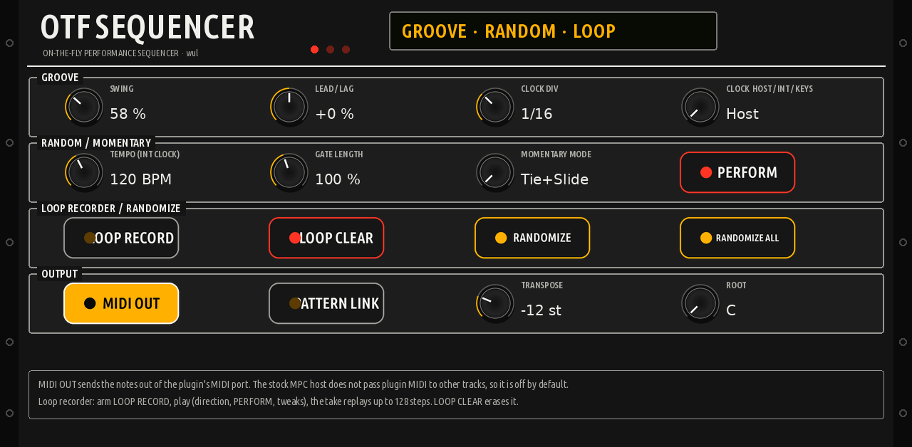
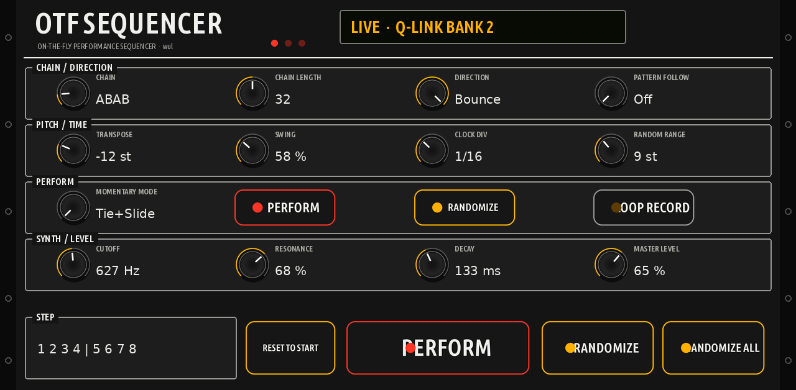
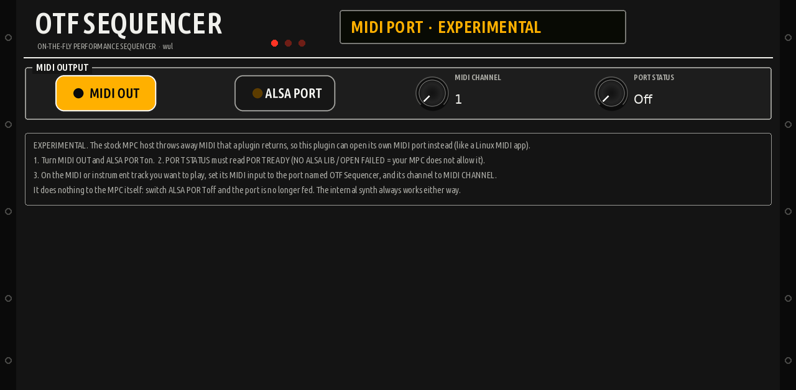
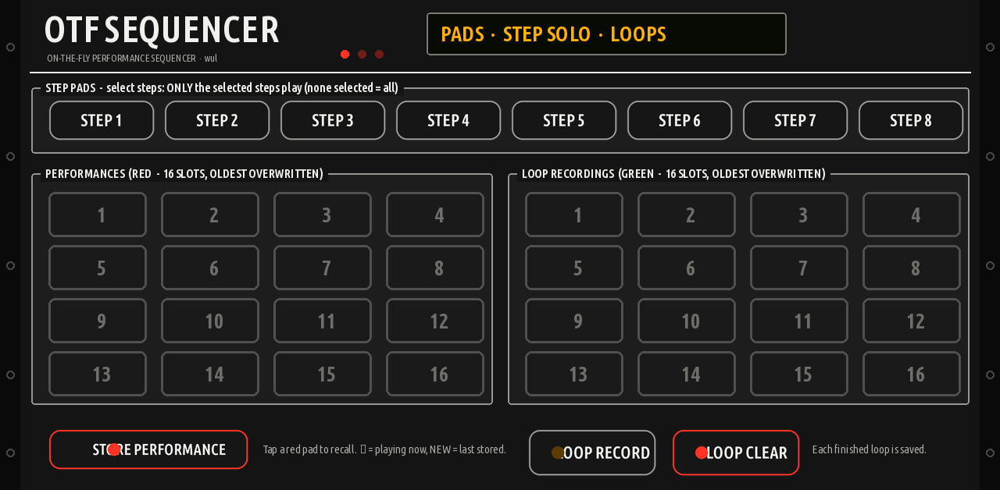
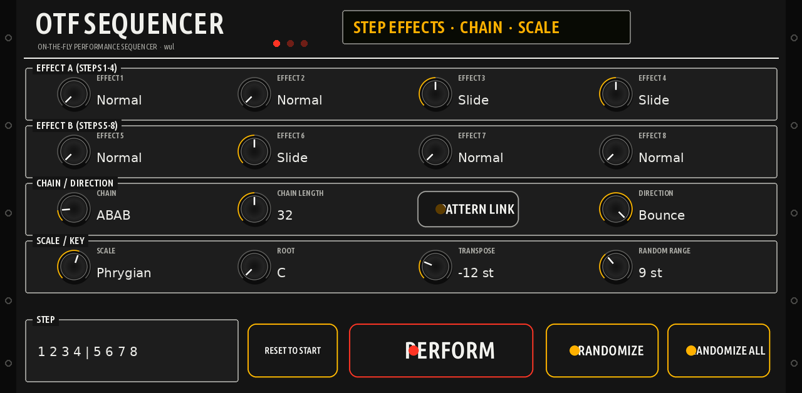
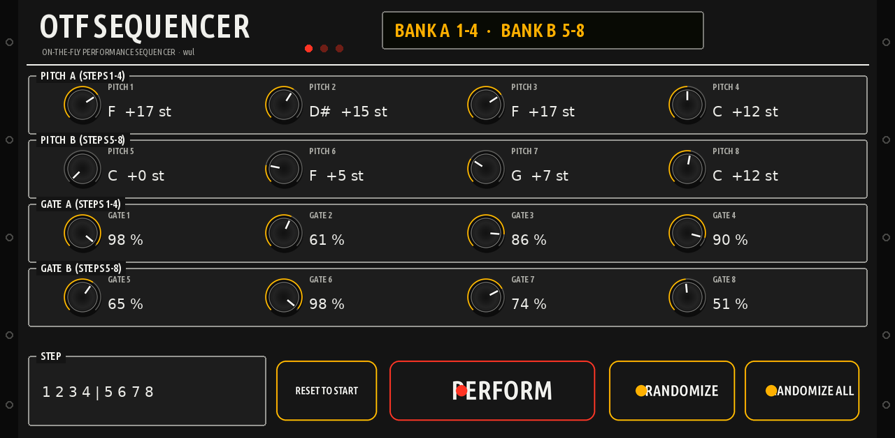
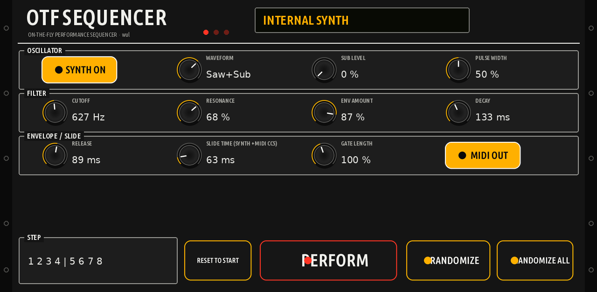

# OTF Sequencer (wul) 1.2.1

A performance step sequencer in the spirit of the Stylophone On-The-Fly, with its own retro synth, so it makes sound by itself on an MPC.

**Requires MPC OS 3.10.1 or later, with External Plugin Support enabled** (Preferences → Enhancements (Beta) → Enable Enhancements and External Plugin Support). Copy the folder `wul - VST - OTF Sequencer` into a `VST2 Plugins` folder at the root of a drive and restart the MPC.

## Screenshots
Previews of the touch-screen pages, rendered from the plugin's skin files (not photos of a real MPC).

## What it does
- **Two 4-step banks, A (steps 1-4) and B (5-8)**: pitch (quantised to the scale), gate length and a step effect each.
- **Step effects**: Normal, Skip, Rest, Tie, Slide, Ratchet x2/x3/x4, Random.
- **Chains** AAAA, BBBB, ABAB, AAAB, ABBB, AABB, ABBA; **chain length** 16/32/64 steps; **Pattern Link** (the first step of each 4-step block slides in from the previous note).
- **Direction** Forward, Reverse, Bounce, switchable instantly.
- **Timing** follows the MPC transport and tempo. Clock divisions 1/4, 1/8, 1/16, 1/32 and triplets, swing 50-75 %, lead/lag. Clock can also be Internal (own tempo) or Keys (starts when you play a key; the held key transposes).
- **Scales**: Chromatic, Major, Minor, Dorian, Phrygian, Mixolydian, Pent Major, Pent Minor; Root, Transpose +-24, Random Range 1-24.
- **PERFORM** (momentary) with a mode: Tie+Slide, Ratchet, Randomize, Hold Step.
- **Loop recorder** (128 steps): arm Loop Record and play with direction, PERFORM and tweaks; the take replays. Loop Clear erases it.
- **RANDOMIZE** (new pitches snapped to the scale and inside Random Range, gates and effects) and **RANDOMIZE ALL** (also chain, scale and synth tone). Each tap is one press.
- **Internal synth**: Saw / Square (+ Sub), saturating low-pass filter with resonance, envelope amount, decay, release, glide (only on slide steps).
- **120 presets** in six groups of 20: 001-020 Acid & 303 Basslines, 021-040 Berlin School & Modular Arps, 041-060 Electro & Breakbeat Leads, 061-080 Dub & Minimal Techno Pulses, 081-100 Ambient & Generative Polyrhythms, 101-120 Ratchet Fills & Experimental.

## Screens
F1 STEPS (Q-Link bank 1: Q1-8 pitch, Q9-16 gate) / STEP FX (effects, chain, scale). F2 LIVE (Q-Link bank 2: Chain, Chain Length, Direction, Scale, Transpose, Swing, Clock Div, Random Range, Momentary Mode, Perform, Randomize, Loop Record, Cutoff, Resonance, Decay, Master Level) / GROOVE. F3 SYNTH. The row of step numbers on F1/F2 shows the playing step in brackets.

## New in 1.2.1
The red and green pad matrices now show which pad is **selected** (the one you last recalled or stored, i.e. what is playing now): a thick white border, bright fill and a white play triangle. The **newest stored** pad keeps a gold outline and a small NEW tag, so you can tell the two apart (a pad can be both). Randomize, Loop Clear and starting a new loop recording clear the selection, because the sound no longer matches any pad.

## New in 1.2.0
- **14 chain modes.** The original seven plus seven with the B bank playing **backwards** (a lower-case letter = that bank reversed): AbAb, AAAb, Abbb, AAbb, AbbA, ABbA, AbBA.
- **Pattern Follow** (LIVE page): *Off*; *Next Chain* steps the Pattern Chain to the adjacent mode after every full chain (16/32/64 steps); *Run Through* plays the next mode on every 16-step pass inside the chain length, so a 64-step chain walks four modes.
- **Reset To Start** button (bottom strip of the STEPS, STEP FX and LIVE pages): the next step played is step 1 of the chain, and the loop restarts with it.
- **Step pads** (PADS page, F2 third page): select steps and ONLY those steps play; none selected = all.
- **PADS page**: 16 red performance slots and 16 green loop-take slots. They roll: when all 16 are full the oldest is overwritten. A red slot stores the 8 steps, effects, chain, scale and performance settings and the synth sound; it is filled by **STORE PERFORMANCE** and automatically just before every Randomize / Randomize All. A green slot is filled every time a loop recording finishes. Tap a pad to recall. The pads are saved with the project. (A plugin cannot colour the MPC's hardware pads, so these are touchscreen pads.)
- **Slide Time** now also goes out as MIDI CC5 (portamento time) with the slide on/off CC65, so a hardware synth slides for the same time as the internal one.
- **Pulse Width** for the synth's square waves, and a global **Gate Length** (25-200 %).
- **Fixes**: a quick touchscreen tap on PERFORM now counts (it is held for at least the next step and is recorded by the loop recorder); the loop buttons follow the button state as well as presses; the RANDOMIZE buttons on LIVE and GROOVE are the right size.

## Experimental MIDI port (new in 1.1.0)
The stock host discards plugin MIDI, so 1.1.0 can open the plugin's **own ALSA MIDI port** (client "OTF Sequencer", port "MIDI Out"), the same way a Linux MIDI program does. Nothing on the MPC is modified. Turn **MIDI Out** and **ALSA MIDI Port** on (F3, second page), check that **Port Status** reads **PORT READY**, then choose that port as the MIDI input of the track you want to play and set its channel to **MIDI Channel**.
- It is **untested on a real MPC**: it was tested against a fake sound library only. On a MPC One or Force the sequencer may not be exposed to plugins; Port Status then shows NO ALSA LIB or OPEN FAILED and nothing else changes.
- Notes leave from a separate thread and arrive within about a millisecond of the audio block they belong to (a few ms), not sample-accurate.
- Port Status and ALSA MIDI Port are appended parameters (never part of presets).

## Honest notes
- **MIDI Out** (host path): the plugin can queue MIDI notes (MIDI Out switch, off by default), but the stock MPC host discards MIDI produced by plugins, so it cannot drive other tracks. Use the internal synth.
- Nothing was tuned by ear or CPU-measured on a real MPC. On a desktop the worst case is about 0.5 % of one core.
- The step display is a text readout refreshed from the audio thread; the skin itself is static.
- Pattern Link is my interpretation of the original's feature.
- Randomize is triggered from the audio thread and has not been checked on hardware.
- Skin generator code is adapted from a GPL-3.0 generator: fine for private use, check before redistributing. Font: Ubuntu Sans (Ubuntu Font Licence).
