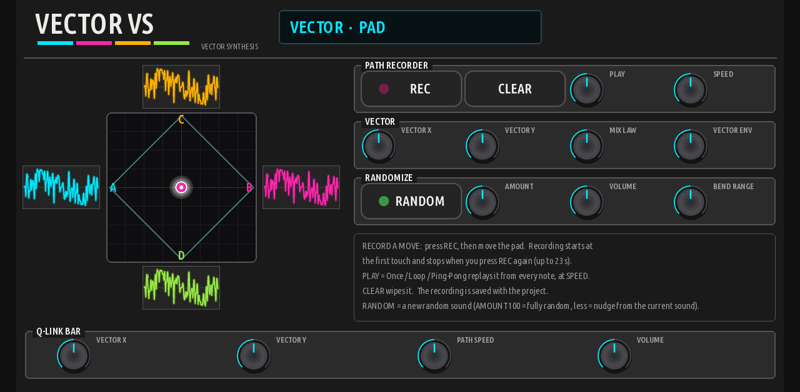
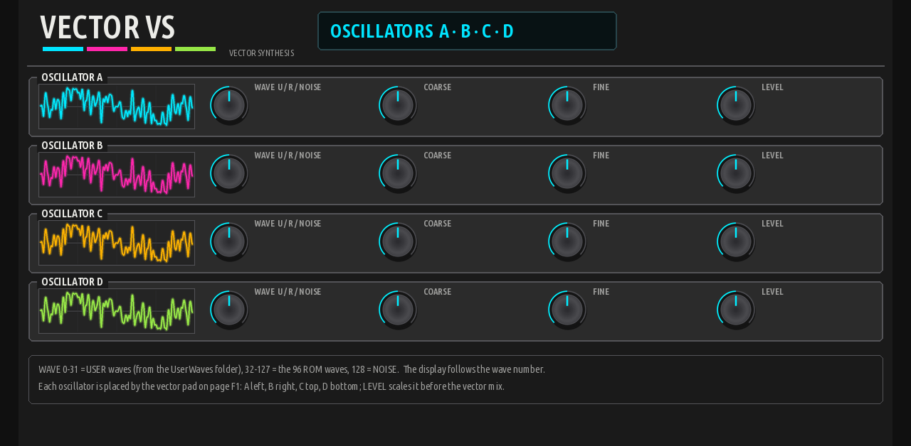
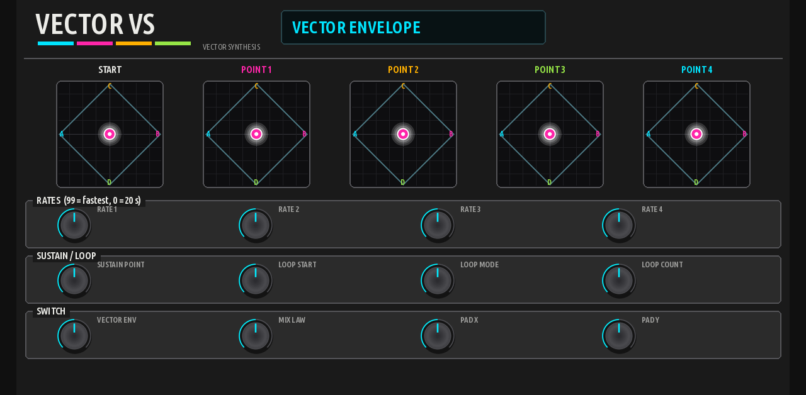
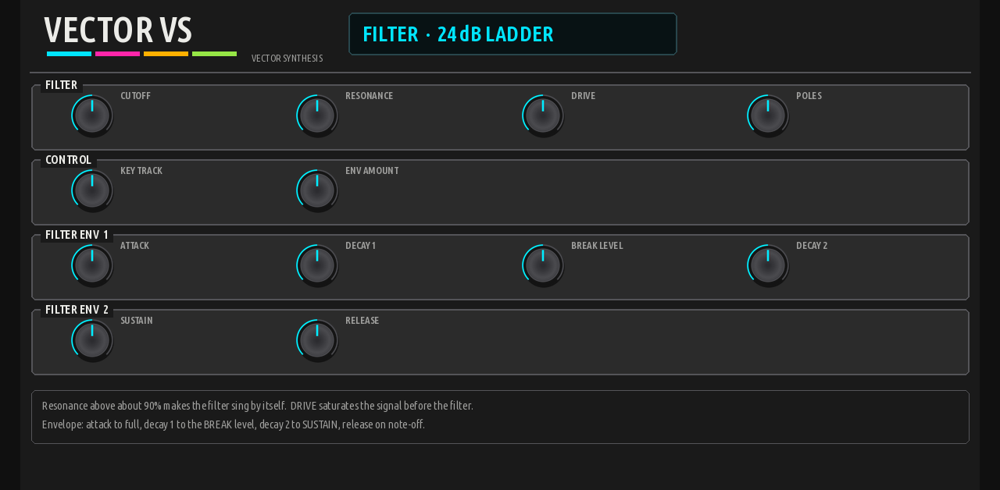
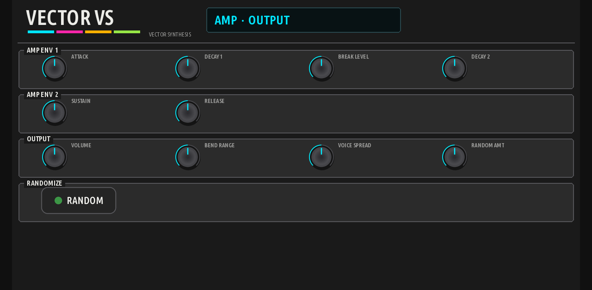
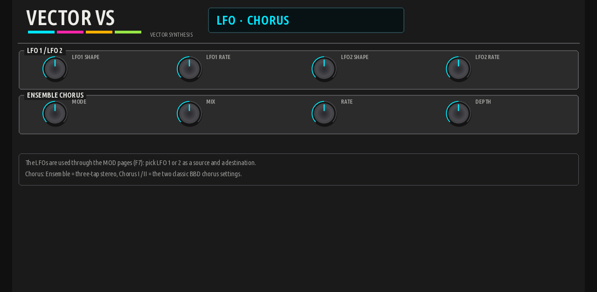
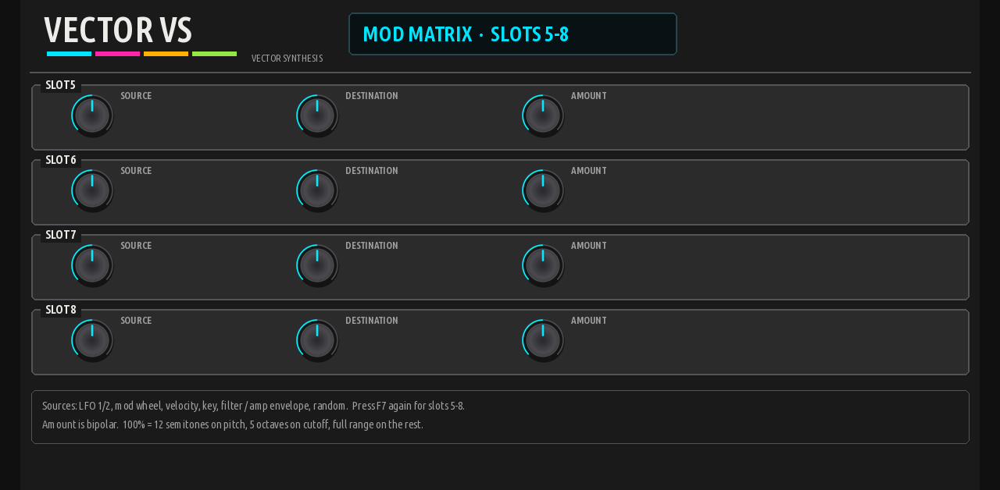

# Vector VS 0.4.0  (wul)

An 8-voice vector-synthesis instrument for the Akai MPC, in the spirit of the Sequential Prophet VS. Four wavetable oscillators (A left, B right, C top, D bottom of the vector pad) are blended by an XY pad that can be moved by hand, by a 5-point vector envelope, or by a **recorded pad movement**.

## Download

| File | For |
|---|---|
| [`downloads/vector-vs-0.4.0-mpc.zip`](downloads/vector-vs-0.4.0-mpc.zip) | **MPC standalone** (32-bit and 64-bit: MPC One, Live, X, Live II, One+, Key 61, Live III, XL ...) |
| [`downloads/vector-vs-0.4.0-win-vst2.zip`](downloads/vector-vs-0.4.0-win-vst2.zip) | Windows 64-bit VST2 (with its own editor window) |
| [`downloads/vector-vs-0.4.0-win-vst2-x86.zip`](downloads/vector-vs-0.4.0-win-vst2-x86.zip) | Windows 32-bit VST2 |

## Install on the MPC (standalone)
1. **Your MPC must run MPC OS 3.10.1 or later.**
2. On the MPC: **Preferences -> Enhancements (Beta) -> Enable Enhancements and External Plugin Support**. Restart if asked.
3. Unzip `vector-vs-0.4.0-mpc.zip` on your computer. You get a folder called **`wul - VST - Vector VS`** (and an `INSTALL.txt`).
4. Copy that whole folder into a folder named **`VST2 Plugins`** at the top level of the drive the MPC will read (SD card, USB stick, or the MPC's internal drive; create the `VST2 Plugins` folder if it does not exist).
5. On the MPC, open a track, choose **Plugin -> Vector VS** (manufacturer "wul"). The 120 factory programs are in the program list.

### Your own waves (optional)
Put WAV files into `wul - VST - Vector VS/Content/UserWaves/` (see the `README.txt` there). Slots U00-U31 are filled in name order; a file whose length is a multiple of 2048 samples is cut into single cycles, other files become one cycle. Empty slots play a generated stand-in.

## Install on Windows (VST2)
Unzip, copy the `Vector VS` folder (contains `vector-vs.dll` and its `Content` / `Plugin Skins` folders) into your VST2 plugin folder (for example `C:\Program Files\Steinberg\VstPlugins`), rescan in your host. Use the 64-bit zip for a 64-bit host, the x86 zip for a 32-bit host.

## What it can do
- **4 oscillators**, 128 waveforms each: 0-31 user, 32-127 ROM single cycles (generated), 128 noise; coarse, fine, level. 2048-sample cycles, band-limited.
- **Vector pad** (linear or equal-power law), **5-point vector envelope** with sustain and loop (forward / alternate / count), and a **path recorder**: press REC, move the pad, play it back Once / Loop / Ping-Pong at 0.25x-4x. Saved with the project.
- **Filter**: CEM3379-style 24 dB ladder low-pass (12 dB option) with self-oscillation and drive; key tracking; filter envelope.
- **Two 5-stage envelopes** (attack, decay 1, break, decay 2, sustain, release) for filter and amp.
- **2 LFOs** (Tri / Saw / Ramp / Square / Random) and an **8-slot modulation matrix** (LFO 1/2, mod wheel, velocity, key, envelopes, random -> pitch, cutoff, resonance, drive, vector X/Y, level, LFO rates ...).
- **Ensemble chorus** (Ensemble / Chorus I / II), voice spread.
- **120 factory presets**, and a **RANDOMIZE** button with an Amount knob.

## Touch pages
| | |
|---|---|
| F1 VECTOR: pad, 4 oscillator displays, recorder, randomize |  |
| F2 OSC: wave, coarse, fine, level for A-D |  |
| F3 V-ENV: vector envelope |  |
| F4 FILTER |  |
| F5 AMP / OUTPUT |  |
| F6 LFO / CHORUS |  |
| F7 MOD matrix (slots 1-4; press F7 again for 5-8) |   |

*The pictures are the skin with the controls drawn in a neutral position; real values and the live pad position show on the MPC.* Every row of four knobs is one Q-Link bank.

## Honest notes
- Not tested on a real MPC yet; tested with the SDK's host simulator and its own engine tests. CPU is unmeasured on the MPC (about 2-3 % of one desktop core for 8 voices).
- Not tuned by ear against a real VS. The XY pad component is described as "less tested" in the MPC SDK; the Vector X / Vector Y knobs do the same job.
- The skin is static: no playhead on the recorded path and no meters.
- The Windows editors are untested on real Windows.
- The 96 ROM waves are an original generated bank (eight morphing families of twelve); no third-party wave data is included. If you own the original instrument's ROM WAV files you can drop them into `Content/Waves/` (see the README there).
- The skin generator is derived from GPL-3.0 code (private use; check before redistributing).

## Source
`source/` has the plugin code, skin generator, preset generator and tests (built with the MPC Plugin SDK from inmusic-software). `Content/Waves` is not included there.
