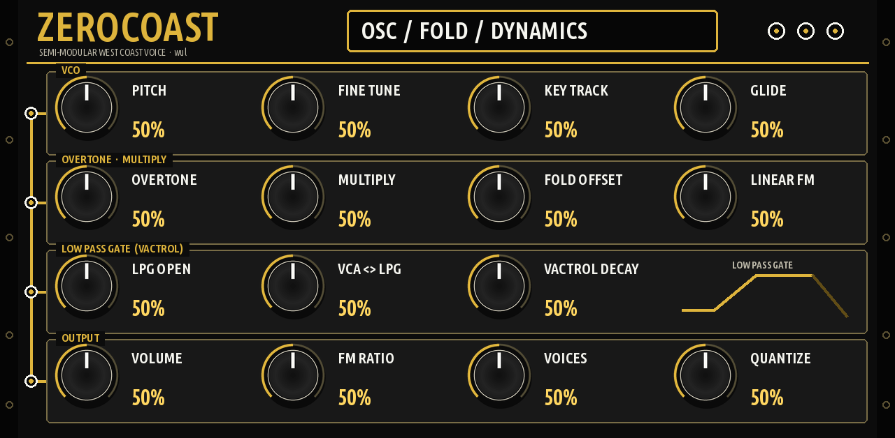
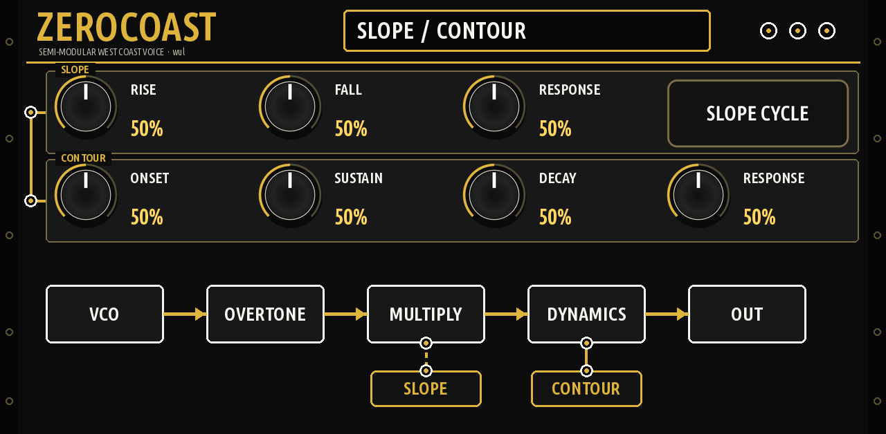
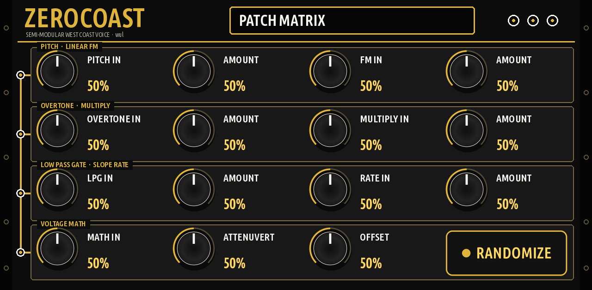
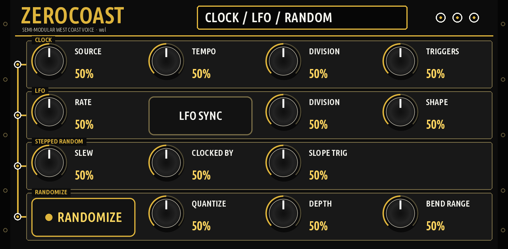

# ZeroCoast 1.1.1  (wul)

A West-Coast semi-modular voice for the Akai MPC standalone, in the spirit of compact modular-style instruments. Original code and artwork; it is not affiliated with any hardware maker. 4 voices (or one gliding mono voice), 120 factory programs.

## Download
| File | For |
|---|---|
| [`downloads/zerocoast-1.1.1-mpc.zip`](downloads/zerocoast-1.1.1-mpc.zip) | **MPC standalone** (32-bit and 64-bit: MPC One, Live, X, Live II, One+, Key 61, Live III, XL ...) |

## Install on the MPC
1. **Your MPC must run MPC OS 3.10.1 or later.**
2. On the MPC: **Preferences -> Enhancements (Beta) -> Enable Enhancements and External Plugin Support**. Restart if asked.
3. Unzip `zerocoast-1.1.1-mpc.zip`. You get a folder called **`wul - VST - ZeroCoast`** (and an `INSTALL.txt`).
4. Copy that whole folder into a folder named **`VST2 Plugins`** at the top level of the drive the MPC reads (SD card, USB stick or internal drive; create the folder if needed).
5. On the MPC open a track and choose **Plugin -> ZeroCoast** (manufacturer "wul"). The 120 factory programs are in the program list.

## Signal path
Triangle-core VCO (Pitch, Fine Tune, Key Track, Glide, Linear FM with FM Ratio) > **Overtone** (blends the triangle toward 2nd / 3rd-harmonic shapes) > **Multiply** (smooth Lockhart-style wavefolder with Fold Offset, 2x oversampled) > **Low pass gate** (vactrol model: amplitude and highs close together; *LPG Balance* blends VCA <-> LPG, *LPG Vactrol Decay* sets the slow, level-dependent tail).
**Slope** = looping / one-shot rise-fall generator with Response (log - linear - exponential) and an end-of-cycle pulse. **Contour** = onset / sustain / decay envelope with Response, normalled to the low pass gate.

## Patch matrix (virtual patch cables)
Six destinations - Pitch, Linear FM, Overtone, Multiply, LPG, Slope Rate - each take one source through an attenuverter (-100..+100): Off, Slope, Contour, LFO, Random, Math, Key, Velocity, Mod Wheel, Slope EOC, Noise. *Voltage Math* = Math Input x Attenuverter + Offset. Modulation runs at a 16-sample control rate (about 2.7 kHz).

## Clock, LFO, random
Clock follows the MPC transport (Host Sync) or runs internally; Clock Division sets the tick; Clock Trigger re-fires Slope / Contour on held notes. The LFO is free (Hz) or tempo-synced. Stepped Random takes a new value on the Clock, the Slope's end-of-cycle, or each note, with Slew. **Hold a note** to hear the riff presets.

## Randomize
RANDOMIZE (on the MATRIX and CLOCK pages and on a Q-Link) re-patches the voice; *Random Depth* 0-100 % sets how far it moves. Pitch snaps to the Quantize scale (Chromatic, Minor, Major, Dorian, Phrygian, Pentatonic), as does anything you patch into Pitch. The low pass gate path is always left audible.

## Pages (every row of four is one Q-Link bank)
| | |
|---|---|
| F1: OSC / FOLD / LOW PASS GATE |  |
| F1 again: SLOPE / CONTOUR |  |
| F2: PATCH MATRIX |  |
| F3: CLOCK / LFO / RANDOM |  |

*The pictures are the skin with the controls drawn at a neutral value; real values show on the MPC.*

## Honest notes
- Not tested on a real MPC by the author beyond first impressions; tested with the SDK's host simulator and its own engine tests (about 1 % of a desktop core for 4 voices).
- A musical emulation of the architecture, not a circuit-level model: the folder is a smooth waveshaper and the vactrol is a two-rate non-linear follower.
- The skin generator is derived from GPL-3.0 code (private use; check before redistributing).

## Source
`source/` has the plugin code, skin and preset generators and the engine tests (built with the MPC Plugin SDK from inmusic-software).
